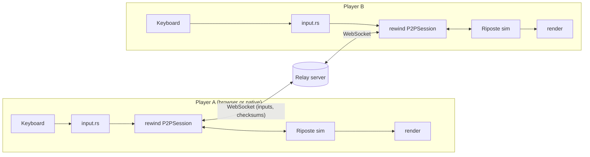

# Riposte — Design Document

Riposte is a 2-player online fighting game written in Rust. Its multiplayer runs on **rewind**, a game-agnostic rollback netcode library developed in the same repo.

---

## 1. Goals and non-goals

**Goals**
- Online 1v1 that feels responsive at 50–150 ms ping, using rollback netcode.
- `rewind` is fully independent of the game, so any deterministic game implementing its trait can use it.
- Provable determinism, through a sync test that forces rollbacks every frame and compares checksums.
- Playable in the browser (WASM) through a room-code link.
- Every part understandable and explainable by both authors.

**Non-goals (v1)**
- More than 2 players, spectators, replays, ranked matchmaking.
- Original art made by Claude. *Changed Nov 2026, at Ram's request:* the art is original 2D pixel art generated by `scripts/art/` (see section 7, "Visuals"). Any file can still be replaced by third-party art with the same path and size.
- More than one stage, or more than one character design (both players use the same moveset).

---

## 2. Repository layout

```
riposte/
├── Cargo.toml            # workspace root
├── README.md             # what it is, how to run it, where to read next
├── CLAUDE.md             # instructions for Claude sessions
├── DESIGN.md             # this file
├── LEARNING.md           # concept → explanation → where it lives in the code
├── PROGRESS.md           # what's built so far: status, gist, files, decisions
├── SETUP.md              # every setup command, explained, to run by hand
├── scripts/build-web.sh  # WASM build into web/
├── web/                  # browser build: index.html + macroquad's JS loader (with 3 quad-net fixes)
├── .cargo/config.toml    # --allow-undefined for the wasm target (JS-provided imports)
├── rewind/               # rollback netcode library (crate: rewind)
│   ├── src/
│   │   ├── lib.rs
│   │   ├── api.rs        # RollbackGame + Transport traits (FROZEN interface)
│   │   ├── input_queue.rs
│   │   ├── snapshot.rs   # ring buffer of saved states
│   │   ├── session/
│   │   │   ├── synctest.rs
│   │   │   └── p2p.rs
│   │   ├── protocol.rs   # messages between peers
│   │   └── transport/    # memory.rs (R3, tests), fake.rs (R4), websocket (R6)
│   ├── tests/convergence.rs # R4: two sessions over 200 random bad networks
│   └── examples/boxes.rs # toy game used to test rewind without Riposte
├── game/                 # the fighting game (crate: riposte-game)
│   └── src/
│       ├── main.rs       # window, menus, main loop
│       ├── menu.rs       # main menu: local / practice / create room / join with code
│       ├── driver.rs     # TickDriver: frames → ticks, input kept between ticks
│       ├── online.rs     # OnlineMatch: GameState + P2PSession over any Transport
│       ├── netplay.rs    # I1: lobby (create/join via WebSocketTransport) + online match screen
│       ├── practice.rs   # Practice vs lag: you vs bot over the fake network
│       ├── bot.rs        # simple computer opponent (inputs only)
│       ├── clock.rs      # real time → fixed 1/60 s ticks
│       ├── session.rs    # LocalSession (both players on one keyboard)
│       ├── sim/          # deterministic simulation (NO floats)
│       │   ├── mod.rs    # Input bits, GameState, advance, hit resolution
│       │   ├── fighter.rs # movement + action state machine
│       │   ├── attack.rs # frame data and hitboxes
│       │   ├── rect.rs   # AABB overlap
│       │   ├── round.rs  # round/match phases and timings
│       │   ├── rng.rs    # seeded xorshift64 PRNG
│       │   ├── checksum.rs # FNV-1a hash for desync detection
│       │   └── rollback.rs # impl RollbackGame for GameState + sync test (G5)
│       ├── render/       # drawing (floats allowed here only)
│       │   ├── mod.rs    # draws the art, placeholder shapes as fallback (Aryaman)
│       │   ├── effects.rs # game feel: flash, shake, hitstop visuals (Ram, G6)
│       │   ├── anim.rs   # sim state → sprite frame; sparks, dust, damage bar
│       │   └── assets.rs # textures + font from the embedded game/assets/
│       └── input.rs      # keyboard → input bitmask and menu keys
│   ├── build.rs          # embeds game/assets/ into the binary
│   └── assets/           # art (PNG) + font (TTF), generated by scripts/art; CREDITS.md
├── scripts/art/          # Python generators for all the art (SETUP.md section 13)
├── server/               # WebSocket relay (crate: riposte-server)
│   └── src/        # main.rs, lib.rs, rooms.rs, protocol.rs, web.rs (serves the browser build when WEB_DIR is set)
└── docs/
    ├── frame-walkthrough.md  # done
    └── exercises.md          # done
```

---

## 3. Architecture



Key points:
- Each client runs the **full simulation**. Only **inputs** travel over the network, never game state.
- The server is a **dumb relay**. It pairs two players by room code and forwards bytes without understanding them.
- `rewind` owns timing, prediction and rollback. The game only knows how to save, load, advance and checksum itself.

---

## 4. The interface between rewind and the game (FROZEN)

This lives in `rewind/src/api.rs`. Both of us build against it from day one. **Changing it needs agreement from both people.**

```rust
/// Implemented by any game that wants rollback.
pub trait RollbackGame {
    /// One player's input for one frame. Riposte uses a u16 bitmask.
    type Input: Copy + PartialEq + Default + Serialize + DeserializeOwned;
    /// A full copy of everything the simulation needs.
    type State: Clone;

    fn save(&self) -> Self::State;
    fn load(&mut self, state: &Self::State);
    /// Advance exactly one tick (1/60 s) using both players' inputs.
    fn advance(&mut self, inputs: [Self::Input; 2]);
    /// Deterministic hash of the current state, used for desync detection.
    fn checksum(&self) -> u64;
}

/// How rewind sends and receives bytes. Swappable: in-memory, fake-latency, WebSocket.
pub trait Transport {
    fn send(&mut self, bytes: &[u8]);
    fn poll(&mut self) -> Vec<Vec<u8>>; // non-blocking: all messages received since last poll
}
```

As built in R1, `api.rs` also holds two small shared definitions the sessions need: `type Frame = u32` (frame numbers, matching the protocol) and the `Event` enum below (`Desync { frame }`, `Stalled`, `Disconnected`).

How the game uses a session, once per 1/60 s tick:

```rust
session.add_local_input(local_input);
for event in session.tick(&mut game) {   // rewind may load/advance the game several times here
    match event {
        Event::Desync { frame } => { /* log loudly */ }
        Event::Stalled => { /* too far ahead of the opponent; skip this tick */ }
        Event::Disconnected => { /* back to menu */ }
    }
}
render(&game);
```

Riposte's input bitmask:

| Bit | Button |
|---|---|
| 0 | LEFT |
| 1 | RIGHT |
| 2 | UP (jump) |
| 3 | DOWN (crouch) |
| 4 | LIGHT attack |
| 5 | HEAVY attack |

---

## 5. How rollback works, tick by tick

Config defaults: `input_delay = 2` frames, `max_prediction = 8` frames, `checksum_interval = 30` frames.

Every tick, `P2PSession::tick` does the following:

1. **Schedule local input.** The local input is assigned to frame `current + input_delay`. A small delay means fewer rollbacks.
2. **Send.** All local inputs not yet acknowledged by the peer are sent in one message. Sending them redundantly means a lost packet is covered by the next one.
3. **Receive.** Remote inputs are read from the transport. Each is compared with what was *predicted* for that frame. Prediction is simply "same as the last confirmed input".
4. **Roll back if needed.** If any prediction was wrong, `F` is the earliest wrong frame. The session loads the snapshot for frame `F`, then re-runs `advance` from `F` up to the current frame with the corrected inputs, saving fresh snapshots along the way.
5. **Stall if too far ahead.** If `current - last_confirmed_remote_frame > max_prediction`, the session does not advance, so it never predicts too far into the future.
6. **Advance.** The session saves a snapshot of the current frame, then calls `advance([local, remote_or_predicted])`.
7. **Desync check.** Every `checksum_interval` frames, once the frame is confirmed for both players, the checksum is sent. If the peer's differs, the session emits `Event::Desync`.

The snapshot ring buffer holds at least `max_prediction + 2` states, since we never roll back further than that.

**Sync test session:** this runs the game locally with no network, and every frame it rolls back N frames, resimulates, and asserts the checksums match the first run. If it passes, the game is deterministic. **The game must pass it before going online.**

---

## 6. Network protocol

Serialization is `bincode` over binary WebSocket frames.

**Peer to peer (opaque to the server):**
```rust
enum PeerMsg<I> {
    Inputs { start_frame: u32, inputs: Vec<I>, ack_frame: u32 },
    Checksum { frame: u32, hash: u64 },
}
```

**Client to server and back:**
```rust
enum ClientMsg { CreateRoom, JoinRoom { code: String }, Relay(Vec<u8>) }
enum ServerMsg { RoomCreated { code: String },
                 MatchStart { player_index: u8, seed: u64 },
                 Relay(Vec<u8>), PeerLeft }
```

The seed in `MatchStart` initializes the game's PRNG so both clients start identically.

As built in R3 (`rewind/src/protocol.rs`), `ack_frame` means "the first of your frames I don't have yet", so 0 means nothing received. Every message resends all inputs from the peer's last `ack_frame` onward.

---

## 7. Game simulation (riposte-game)

**Determinism rules (non-negotiable):**
- No `f32`/`f64` anywhere in `sim/`. Positions use **integer subpixels**: 1 pixel = 256 units, stored in `i32`.
- No `HashMap`/`HashSet` iteration in the sim (use `Vec` or arrays).
- No system time and no `thread_rng`. Randomness comes only from a xorshift PRNG stored in `GameState`.
- The sim never reads anything from rendering or the window. The tick rate is fixed at 60/s.
- Checksum uses FNV-1a over the state's fields (our own ~15-line implementation, so it's identical on native and WASM).

**State, as built (after G4):**
```rust
struct GameState {
    frame: u32,
    inputs: [Input; 2],       // last tick's inputs, for "just pressed"
    fighters: [Fighter; 2],
    round: Round,             // number, wins [u8; 2], phase, timer
    rng: Rng,                 // xorshift64 state, seeded by GameState::new(seed)
}

enum Phase { Ready, Fight, RoundOver { winner: Option<u8> }, MatchOver { winner: u8 } }

struct Fighter {
    x: i32, y: i32,           // centre of the feet, subpixels, y down
    vx: i32, vy: i32,         // subpixels per tick
    facing: i8,               // +1 right, -1 left
    action: Action,
    action_frame: u16,        // ticks since the attack started
    hitstun: u16,             // ticks of hitstun left
    health: i16,              // starts at 1000
    attack_connected: bool,   // this swing already hit
}

enum Action { Idle, Walk, Crouch, Jump, Light, Heavy, Hitstun, Knockdown }
```

**Tick order** (`GameState::advance`):
0. Outside `Fight`, both inputs are replaced with 0.
1. Both fighters turn to face each other, using start-of-tick positions.
2. Presses are worked out as `held & !last_tick`.
3. Both fighters step: timers, then input if actionable, then movement, floor and walls.
4. During `Fight` only, both hits are checked, then applied, then KO is checked.
5. The round timer ticks, which may change phase or reset the fighters.
6. `frame` and `inputs` are stored.

Reading before writing keeps the result independent of which player is updated first.

**Movement:**
- Walk: 4 px/tick forward, 3 back.
- Jump: −15 px/tick takeoff, gravity 0.75 px/tick², so 41 ticks long with a 157.5 px peak. No air control.
- Fighter box: 80×200 px, or 80×120 px crouching.
- Left + right together is neutral.

**Attacks** have frame data, with startup, active and recovery frames. Hitboxes exist only during active frames and collide with the opponent's hurtbox (AABB overlap). Hits apply damage, hitstun and knockback. One hit per swing; simultaneous hits trade.

| | Startup | Active | Recovery | Damage | Hitstun | Knockback | Height | On hit |
|---|---|---|---|---|---|---|---|---|
| Light | 4 | 3 | 8 | 50 | 15 | 3 px/tick | high (130–160 px) | +4 |
| Heavy | 10 | 4 | 20 | 120 | 20 | 6 px/tick | mid (60–110 px) | −4 |

**Rounds:**
- Best of 3. READY 1 s (input ignored), then fight.
- KO gives 2 s of round over, then the next round with fighters reset and the score kept.
- 2 wins gives 4 s of match over, then a new match.
- A double KO is a draw and the round is replayed.

**Checksum:** FNV-1a over every field of `GameState`, in fixed order, little-endian, with explicit enum tags (`GameState::checksum`).

**Not built yet:** blocking, round timer, air attacks and pushboxes (see PROGRESS.md, open questions).

**Stage:** logical 1280×720, flat floor at y = 640 px, walls at both edges. Rendering scales this to the window.

**Controls (local):**
- P1: A/D move, W jump, S crouch, F light, G heavy.
- P2: arrow keys, K light, L heavy.

**Game feel** is render-only and never affects the sim: hitstop shown visually, screen shake, hit flashes, health bar animation.

**Visuals:** The art is 2D pixel art at 1x, generated by `scripts/art/` into `game/assets/` (Ram asked for it in Nov 2026; before that the rule was third-party art only). `game/build.rs` embeds the files; `render/` draws them, falling back to plain placeholder shapes for anything missing, and holding Tab shows the sim's boxes over the art. Hitboxes, hurtboxes and positions stay defined in the sim in integer subpixels; art is drawn on top of them and never changes them.

---

## 8. Relay server (riposte-server)

- `tokio` + `axum` with a WebSocket route `/ws`.
- `CreateRoom` makes a 4-letter room code. `JoinRoom` with that code pairs the second player. The server then sends `MatchStart` to both with player indices 0 and 1 and a random seed.
- After that, any `Relay(bytes)` from one player is forwarded unchanged to the other.
- Disconnects send `PeerLeft` and close the room. Rooms idle for over 5 minutes are deleted.
- Logging uses `tracing`. It's deployable as a single binary or Docker image to a free tier host. The browser needs `wss://` when the game page is served over HTTPS.

---

## 9. Dependencies

| Crate | Used in | Why |
|---|---|---|
| macroquad | game | Window, input, 2D drawing; compiles to WASM easily |
| quad-net | rewind (ws transport, browser only) | WebSocket client for WASM. Its desktop half aborts on current Rust on Windows (R6), so desktop uses tungstenite |
| tungstenite | rewind (ws transport, desktop only) | Blocking WebSocket client, switched to non-blocking after the handshake; already in the tree via tokio-tungstenite. Feature `rustls-tls-webpki-roots` adds `wss://` |
| rustls (feature `ring`) | rewind (desktop only) | TLS for `wss://` to an HTTPS host. Pure-Rust TLS, so no OpenSSL; the `ring` backend avoids the CMake/NASM that the default backend needs |
| serde, bincode | rewind, server | Message serialization |
| tokio, axum | server | Async runtime + WebSocket server (tokio `fs` feature: serves the web build, `web.rs`) |
| thiserror / anyhow | libs / binaries | Error handling |
| tracing, tracing-subscriber | server | Logs |
| tokio-tungstenite, futures-util | server (dev-dependencies, tests only) | WebSocket client so `server/tests/relay.rs` can drive a real server (added in S1) |

Any new dependency must be justified in the session summary.

**Known risk:** WebSocket support from WASM via `quad-net`. Do a spike early in milestone R6 and G7. Fallback: online play native-only for v1, with the browser build offering local 2-player. *Found in G7:* macroquad 0.4.16's `mq_js_bundle.js` fails to register its bundled quad-net plugin in the browser (`register_plugin is not defined`). The R6 spike should start there.

---

## 10. Division of labour

Ownership is by milestone and file, not by crate.

| | Aryaman | Ram |
|---|---|---|
| Owns | R3 (`rewind/src/session/p2p.rs`, `rewind/src/snapshot.rs`), R4 (`rewind/src/transport/fake.rs` + its tests), `game/` including placeholder drawing and art integration in `game/src/render/mod.rs`, final integration, WASM, deployment | R1 (`rewind/src/api.rs`, `rewind/src/input_queue.rs`, `rewind/src/lib.rs`), R2 (`rewind/src/session/synctest.rs`, `rewind/examples/boxes.rs`), R5, R6 (`rewind/src/transport/websocket.rs`), `server/`, G6 (new files under `game/src/render/`, e.g. `render/effects.rs`) |
| Credits run out | Nov 5, 1:29 PM | Nov 4, evening |

### Milestones

✅ = done, ◐ = partly done. Current status, test count and open questions are in PROGRESS.md.

**Aryaman**
- ✅ **R3:** `P2PSession`: prediction, snapshot ring buffer, misprediction detection, rollback + resim. Tested with an in-memory transport pair. *R5 builds on it, so it must merge by Sat Oct 31 night.*
- ✅ **R4:** Fake-network transport (latency, jitter, packet loss) and convergence tests across many seeds.
- ✅ **G1:** macroquad window, fixed 60 Hz tick loop (accumulator), keyboard → bitmask, trivial `LocalSession` (both inputs from one keyboard).
- ✅ **G2:** Fixed-point movement: walk, jump, gravity, floor, walls, facing.
- ✅ **G3:** Attacks: action state machine, frame data, hitboxes/hurtboxes, damage, hitstun, knockback.
- ✅ **G4:** Rounds, health bars, KO, reset, PRNG + FNV checksum.
- ✅ **G5:** Implement `RollbackGame`. **Must pass `SyncTestSession`.** *Passes: 4 seeds × 6000 frames, 8-frame rollback every tick.*
- ✅ **G7:** Main menu (create room / join with code), WASM build. *Online items show a notice until I1 connects them.*

**Ram**
- ✅ **R1:** Crate skeleton, `api.rs` traits, `InputQueue` with unit tests.
- ✅ **R2:** `SyncTestSession` + `examples/boxes.rs` toy game. *Needed by Aryaman for G5.*
- **R5:** Checksum exchange, desync event, stall when too far ahead (builds on R3).
- **R6:** WebSocket transport (quad-net), with a native/WASM spike done first.
- ✅ **S1:** Relay server: rooms, pairing, `MatchStart`, forwarding.
- ✅ **S2:** Disconnects, timeouts, logging, Dockerfile.
- ◐ **G6:** *(partly done: flash and shake; see PROGRESS.md)* Game feel, render-only (new files under `game/src/render/`, e.g. `render/effects.rs`, called from Aryaman's `render/mod.rs`): hit flash, shake, hitstop visuals, tuning of frame data.

**Together**
- ◐ **I1:** Online native vs native through the relay, tested on two laptops. *Code done (`netplay.rs`); verified browser vs browser through the real relay in the sandbox; the two-laptop test is still to do.*
- ✅ **I2:** Online in the browser. *The page picks its relay address; verified browser vs browser in the sandbox.*
- ◐ **I3:** Deploy server + client, public link in README. *Prep done: the relay serves the web build (`WEB_DIR`) and the Dockerfile includes it. Desktop `wss://` is done. A host and the README are still to do.*

**Dependencies**
- R3 needs R1 merged first.
- R5 needs R3.
- G5 needs R2.

### Schedule

| Date | Ram | Aryaman |
|---|---|---|
| Fri Oct 30 (night) | R1 | Workspace + G1 |
| Sat Oct 31 | R2 | R3 (must merge by Sat night, R5 depends on it) |
| Sun Nov 1 | S1, S2 | R4, G2 |
| Mon Nov 2 | R5, R6 | G3, G4 |
| Tue Nov 3 | G6, finish R6 | G5 (sync test), G7 |
| Wed Nov 4 (day) | **I1 together**, then LEARNING.md + docs for their parts | **I1 together** |
| Wed Nov 4 (night) to Thu Nov 5 1 PM | Credits expired | I2, I3, docs/frame-walkthrough.md, docs/exercises.md, README |

Each person's last ~$15 goes to learning material before their credits expire (see section 12).

---

## 11. Git workflow

- `main` always builds and passes `cargo test --workspace`.
- One branch per milestone, e.g. `rewind/r3-p2p-session` or `game/g3-attacks`. Merge through a PR.
- Each person reads the other's PRs. A quick skim is fine; the point is to learn both halves.
- Any PR touching `rewind/src/api.rs` or the protocol enums needs explicit approval from both.
- Commit messages explain **what and why**, because the history is part of the study material.

---

## 12. Learning deliverables

These are produced before credits expire:
- **LEARNING.md:** every concept (rollback, prediction, fixed-point, determinism, ring buffers, AABB, frame data, async relay…), each explained from first principles with the file/function where it lives.
- **SETUP.md:** every setup step and command, explained, so the whole thing can be built and run without Claude.
- **docs/frame-walkthrough.md:** one frame traced end to end: key press → bitmask → rewind → network → peer → rollback → render.
- **docs/exercises.md:** small changes that prove understanding, e.g. "add a third attack", "change input_delay and observe rollbacks", "hide state outside `GameState` and watch the sync test catch it". *Correction made while writing it:* a float that is part of the saved state is **not** caught by the sync test (the same binary rounds the same way every time on one machine); the exercise shows that, and why the browser-vs-desktop check and the runtime checksum exchange exist.
