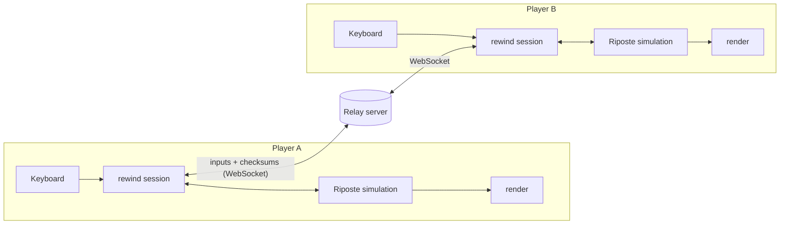

# Riposte

A two-player online fighting game written in Rust, with **rollback netcode** built from scratch. Both players run the whole game; only button presses travel over the network, and a wrong guess about the other player is corrected by rewinding and replaying a few frames, invisibly.

**Play it:** `TODO: public link goes here once the game is deployed (see SETUP.md section 12).`

Everything is placeholder graphics (grey boxes and text): the focus is the netcode and the simulation.

## Try it locally

You need Rust (see `SETUP.md` section 1; on Linux also section 2).

```bash
cargo run -p riposte-game
```

| | Move | Jump | Crouch | Light | Heavy |
|---|---|---|---|---|---|
| Player 1 | A / D | W | S | F | G |
| Player 2 | ← / → | ↑ | ↓ | K | L |

The main menu offers:
- **Local 2-player:** both on one keyboard. Best of 3 rounds. Esc goes back.
- **Practice vs lag:** you against a bot through the real rollback netcode, with adjustable fake lag (keys 1–4) and a live count of frames rolled back.
- **Create / Join online room:** play someone else through the relay server (below).

### Online (two players)

```bash
cargo run -p riposte-server
```

Start the game on both machines, choose **Create online room** on one, and **Join online room** with the 4-letter code on the other. For two laptops, set `RIPOSTE_SERVER=ws://<server-ip>:8080/ws` on both. The relay can also serve the **browser version**: build it with `./scripts/build-web.sh`, run `WEB_DIR=web cargo run -p riposte-server`, and open http://localhost:8080 in two windows. Details are in `SETUP.md` (sections 9, 11, 12).

## How it works



- **`rewind/`**: the rollback library, independent of the game. It knows how to save, load, advance and checksum *any* game that implements one small trait, and how to predict, roll back and resimulate. Transports are swappable: in-memory, a deterministic fake network with lag and loss, and WebSocket (desktop and browser).
- **`game/`**: the fighting game. A deterministic simulation (integers only, 60 ticks per second) plus placeholder drawing on macroquad. It passes rewind's sync test, which forces a rollback on every tick for thousands of frames.
- **`server/`**: a small relay that pairs two players by room code and forwards their bytes without understanding them.

## Testing

```bash
cargo test --workspace
```

About 185 tests, including: the sync test on the real game, 200 random bad-network runs where both peers must end identical, and two rollback sessions playing through a real server over real sockets.

## Read next

| File | What's in it |
|---|---|
| `docs/frame-walkthrough.md` | One key press traced through the whole system |
| `docs/exercises.md` | Small changes that test your understanding |
| `LEARNING.md` | Every concept explained from first principles, with where it lives in the code |
| `DESIGN.md` | Architecture, the frozen interface, protocol, milestones |
| `PROGRESS.md` | What is built and what is left |
| `SETUP.md` | Every setup command, explained |
| `CLAUDE.md` | Working rules for AI sessions on this repo |

## Credits

Built by Aryaman Panigrahi and Ram, with Claude Code as a coding assistant: Aryaman on the game, the rollback session and integration; Ram on the rollback library's foundations, the WebSocket transport, the relay server and game-feel effects. See `DESIGN.md` section 10 for the split.
