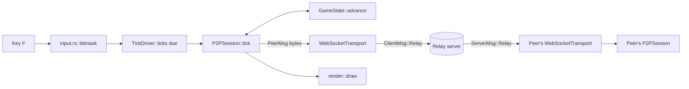

# One frame, end to end

This traces **one key press** through the whole game, in online play: from your finger to the other player's screen. Every step names the file and function, so you can open the code and follow along. Concepts are explained in `LEARNING.md`; this file shows how they connect.

We follow a **light attack** (`F`) pressed by player 1, who is playing player 2 over the relay.

## 1. Key press → bitmask (`game/src/input.rs`)

`read_either_player()` asks macroquad whether each key is held. A key counts if it is **down now or was pressed since the last frame** (`held_or_tapped`), so a very quick tap can't fall between two frames. Each key sets one bit of a `u16`:

| Bit | Button | Value |
|---|---|---|
| 0 | LEFT | 1 |
| 1 | RIGHT | 2 |
| 2 | UP | 4 |
| 3 | DOWN | 8 |
| 4 | LIGHT | 16 |
| 5 | HEAVY | 32 |

Holding `D` and `F` gives `RIGHT | LIGHT` = 18. This number is the **only** thing about your keyboard the rest of the system ever sees.

## 2. Frames → ticks (`game/src/driver.rs`, `game/src/clock.rs`)

The screen draws at whatever rate the monitor allows (30 to 240 times a second), but the game must advance exactly 60 times a second.

- `main.rs` calls `OnlineScreen::update(elapsed, input)` once per **render frame**.
- `TickDriver::frame` ORs this frame's input into a buffer and asks `FixedClock::advance` how many ticks are due. The clock banks time in units of 1/60,000,000 s so that one tick is exactly 1,000,000 units: no rounding drift, no floats.
- On a 144 Hz screen most frames have **0** ticks due. The buffered input waits for the next tick, so a tap is never lost. On a slow frame, up to 4 ticks run at once.

## 3. The session tick (`rewind/src/session/p2p.rs`, `P2PSession::tick`)

`OnlineMatch::tick` hands the input to the session and calls `tick`. The numbered comment at the top of that file lists the steps; here they are with our press:

1. **`receive`:** read what the peer sent since last tick. Each `PeerMsg::Inputs` goes into the peer's `InputQueue`. If a real input differs from what we **guessed** (the guess is "same as their last input"), the queue remembers the first wrong frame.
2. **`rollback_to`** (only if a guess was wrong): load the snapshot from just before that frame and re-run every frame up to now with the real inputs. See "A rollback" below.
3. **Stall check** (`too_far_ahead`): if we are 8 frames (`max_prediction`) ahead of the peer's last confirmed input, don't advance this tick. Still send, and report `Event::Stalled`.
4. **Schedule our input:** the press lands on frame `current_frame + input_delay`, i.e. **2 frames later**. This delay is what gives the packet time to reach the peer before they need it.
5. **`send`:** build `PeerMsg::Inputs { start_frame, inputs, ack_frame }`: every local input the peer has not acknowledged yet, plus "I have all your frames before `ack_frame`". Resending everything unacknowledged means a lost packet is covered by the next one.
6. **`advance_frame`:** save a snapshot of the state, read both players' inputs for this frame from the two queues (ours confirmed, theirs confirmed or guessed), call `GameState::advance`.
7. **`exchange_checksums`:** every `checksum_interval` frames, once confirmed, send our hash of the state and compare with the peer's. A mismatch is `Event::Desync`.
8. **`forget_old_inputs`:** drop inputs no rollback or resend can need.

## 4. The simulation step (`game/src/sim/mod.rs`, `GameState::advance`)

Our `RIGHT | LIGHT` arrives as `inputs[0]`. In this order:

1. Both fighters turn to face each other, using positions from the **start** of the tick (so player order can't matter).
2. `pressed = inputs & !last_tick_inputs`. Attacks start on a **fresh press**, not a hold.
3. `Fighter::step` for each fighter: timers first, then, if the fighter is actionable, `ground_control`. `LIGHT` pressed → `start_attack(Action::Light)`: the fighter is rooted and `action_frame` starts counting.
4. During the attack's **active frames** (4, 5, 6 for the light) the hitbox exists. `check_hit` tests it against the opponent's hurtbox (`Rect::overlaps`). Both players' hits are checked **before** either is applied, so simultaneous hits trade.
5. On a hit, the attacker's streak is updated (`register_hit`: punches and kicks landed, and a 1.5 s timer), then the defender's `take_hit` runs: 50 damage, 15 ticks of hitstun, knockback of 3 px/tick away from the attacker, and the defender's own streak ends. (Three punches in a row would have unlocked the dynamite punch for the *next* press; see `sim/combo.rs`.)
6. KO check, round timer, `frame += 1`, and the inputs are stored for the next tick's "just pressed" test.

All positions and speeds are integers (256 subpixels per pixel), so the result is the same on every machine.

## 5. Over the network

- `P2PSession` serializes the `PeerMsg` with `bincode` and calls `Transport::send`.
- `WebSocketTransport::send` (`rewind/src/transport/websocket.rs`) wraps those bytes in `ClientMsg::Relay(bytes)` and sends one binary WebSocket frame. On desktop this is tungstenite; in the browser it is quad-net and the page's JavaScript.
- The relay (`server/src/lib.rs` `handle_socket`, `server/src/rooms.rs` `Rooms::relay`) does **not** understand the bytes. It looks up which room the connection is in and puts them, unchanged, in the other player's outbox as `ServerMsg::Relay(bytes)`.
- The peer's `WebSocketTransport` reads the frame in `pump`, unwraps it, and holds it until the peer's next `P2PSession::tick` calls `poll()`. That tick is step 1 above, from the other side.

## 6. Drawing (`game/src/render/mod.rs`)

After the ticks, `render::draw` reads the `GameState` (it never writes to it):

- `Effects::observe` (`render/effects.rs`) notices a health drop and starts the hit flash and screen shake. They count **sim ticks**, so they last the same at any frame rate.
- `px()` is the one place where integer subpixels become `f32` pixels. `View` scales the 1280×720 logical stage to the window with black bars where needed.
- `Animator::observe` and `pose` (`render/anim.rs`) pick the fighter's sprite drawing from the state: the light attack's `action_frame` 4 to 6 shows drawing 02, the full-reach punch, so the fist is on screen exactly while the hitbox exists. A hit also spawns a spark there.
- Holding Tab draws the hurtboxes (green) and an active hitbox (red outline) over the art: those boxes, not the drawing, are what the hit detection uses.

## A rollback, with numbers

We are about to simulate frame 100 (`current_frame` = 100). The peer's input for frame 97 arrives and differs from our guess.

1. `receive` puts it in the peer's queue; the queue records `first_incorrect = 97`.
2. `rollback_to(97)` loads the snapshot saved **just before frame 97**, clears the old guesses, and re-runs frames 97, 98 and 99 with real inputs: 3 frames re-simulated (`rollback_frames += 3`).
3. `current_frame` is 100 again, and the tick carries on with step 3 above.

All of this happens inside one call, before anything is drawn, so you never see the wrong version. The deepest possible rollback is `max_prediction` (8) frames; the stall check is what guarantees we never need a snapshot older than the ring buffer holds (`max_prediction + 2` = 10 states).

## Why it stays in sync

Both machines run the **whole** simulation and only inputs travel. That works only because:

- `GameState::advance` is a pure function of (state, inputs): no floats, no clocks, no unseeded randomness.
- `GameState` holds **everything** the simulation needs, so `save`/`load` is a plain clone.
- Both start from the same seed (`MatchStart` from the relay).

The sync test (`game/src/sim/rollback.rs`) proves the first two on every run of `cargo test`; the checksum exchange (step 7) watches for any drift during a real match.
